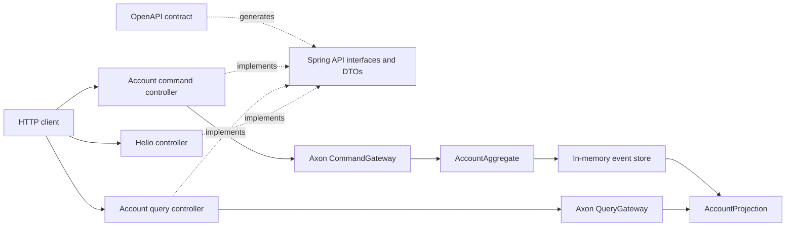

# CQRS Banking Service

A Java 21 and Spring Boot sample service demonstrating **CQRS (Command Query
Responsibility Segregation)** and **event sourcing** with Axon Framework. The
application is organized as a modular monolith with Spring Modulith, and its
HTTP API is defined contract-first in OpenAPI.

> **Status:** This repository is a learning and development sample. Its event
> store and account read model are in memory, so application data is lost when
> the process stops. It does not provide authentication or production-grade
> persistence and should not be exposed as a production banking service without
> additional design, implementation, and security review.

## Contents

- [CQRS Banking Service](#cqrs-banking-service)
  - [Contents](#contents)
  - [What the application does](#what-the-application-does)
  - [Technology stack](#technology-stack)
  - [Editor and formatting conventions](#editor-and-formatting-conventions)
  - [Architecture](#architecture)
  - [Project layout](#project-layout)
  - [Prerequisites and setup](#prerequisites-and-setup)
  - [Build, test, and run](#build-test-and-run)
  - [HTTP API](#http-api)
    - [API documentation](#api-documentation)
  - [OpenAPI-first development](#openapi-first-development)
    - [Controller conventions](#controller-conventions)
  - [Extending the account feature](#extending-the-account-feature)
  - [Adding a feature module](#adding-a-feature-module)
  - [Testing practices](#testing-practices)
  - [Configuration and operations](#configuration-and-operations)
  - [Engineering and production considerations](#engineering-and-production-considerations)

## What the application does

The sample exposes account operations to create accounts, deposit and withdraw
money, and query account details. It also includes a small greeting endpoint.
Account state changes are sent as commands to an Axon aggregate. The aggregate
validates commands and emits events; an event-handling projection maintains an
in-memory read model for account queries.

The OpenAPI contract is the source of truth for the HTTP routes, generated
Spring API interfaces, and generated request and response models. Application
controllers implement those interfaces rather than declaring route annotations
themselves.

## Technology stack

| Area                            | Technology                                                                   |
| ------------------------------- | ---------------------------------------------------------------------------- |
| Language and runtime            | Java 21                                                                      |
| Application framework           | Spring Boot 4.1.1                                                            |
| CQRS and event sourcing         | Axon Framework 4.13.2                                                        |
| Module boundaries               | Spring Modulith 2.1.1                                                        |
| HTTP and validation             | Spring MVC and Spring Boot Validation                                        |
| API contract and generated code | OpenAPI 3.0.3, OpenAPI Generator Maven Plugin 7.12.0                         |
| API documentation UI            | springdoc-openapi 3.1.0                                                      |
| Build                           | Maven Wrapper                                                                |
| Tests                           | JUnit 5, Spring Boot Test, Spring Modulith Test, Mockito, MockMvc, Axon Test |

Dependency and generator configuration is maintained in [`pom.xml`](pom.xml).

## Editor and formatting conventions

The repository root [`.editorconfig`](.editorconfig) defines shared baseline
formatting settings for EditorConfig-aware IDEs and editors:

- UTF-8 encoding, a final newline, and trimmed trailing whitespace by default.
- LF line endings for source and documentation files; CRLF for Windows `.cmd`
  and `.bat` scripts.
- Spaces instead of tabs, with four-space indentation by default and for Java.
- Two-space indentation for YAML, JSON, XML, HTML, and Markdown.
- Markdown preserves trailing whitespace because two trailing spaces can be
  used intentionally to create a hard line break.

`root = true` makes this file the project's settings boundary; parent-folder
EditorConfig files do not override it. Most current IDEs support EditorConfig
natively. If yours does not, enable its EditorConfig support or install the
appropriate plugin. Reopen the file or reformat it if it was already open when
you added this configuration.

EditorConfig standardizes editor behavior; it is not itself a Java, YAML, or
Markdown formatter and cannot guarantee that every formatter follows every
setting. Keep using the project's Maven build and language-specific formatters
when available. Do not manually format or commit generated files under
`target/generated-sources`.

## Architecture



The main account write flow is:

1. `AccountCommandController` translates an HTTP request into an account
   command and dispatches it through Axon's `CommandGateway`.
2. `AccountAggregate` validates the command and applies the corresponding
   domain event.
3. Axon stores the event using the configured in-memory event storage engine
   and delivers it to event handlers.
4. `AccountProjection` updates a concurrent in-memory map used to answer
   account queries.
5. `AccountQueryController` dispatches queries through Axon's
   `QueryGateway` and maps account views to generated HTTP response models.

The account feature's public commands, queries, events, and view are in the
`com.ultims.cqrs.account` package. Its aggregate and web controllers are
implementation details under `com.ultims.cqrs.account.internal`. Cross-cutting
Spring configuration is under `com.ultims.cqrs.config`.

## Project layout

```text
src/
├── main/
│   ├── java/com/ultims/cqrs/
│   │   ├── CqrsApplication.java
│   │   ├── account/
│   │   │   ├── commands, queries, events, and AccountView
│   │   │   └── internal/
│   │   │       ├── command/  # Account aggregate and command HTTP controller
│   │   │       └── query/    # Account projection and query HTTP controller
│   │   ├── hello/internal/   # Greeting HTTP controller
│   │   └── config/           # Axon, OpenAPI, and Spring MVC configuration
│   └── resources/
│       ├── application.yaml
│       └── static/openapi.yaml  # Authoritative API contract
└── test/java/com/ultims/cqrs/
    ├── account/internal/command/
    ├── account/internal/query/
    ├── config/
    └── hello/internal/

target/generated-sources/openapi/  # Build output; do not edit or commit
```

Generated interfaces and DTOs are written beneath `target/generated-sources`.
They are build artifacts, not source files. Edit the OpenAPI contract and
regenerate them instead of editing generated files.

## Prerequisites and setup

- A Java 21 JDK. Confirm the selected runtime with `java -version`.
- Git, if you are cloning the repository.
- No separately installed Maven is required; the Maven Wrapper is included.

Clone the repository and enter its root directory:

```bash
git clone <repository-url>
cd cqrs
```

The wrapper downloads the Maven distribution and dependencies as needed. On
macOS and Linux, invoke it with `./mvnw`. On Windows Command Prompt or
PowerShell, use `mvnw.cmd` with the same Maven goals.

## Build, test, and run

Run commands from the repository root:

| Goal                               | macOS / Linux                             | Windows                                     |
| ---------------------------------- | ----------------------------------------- | ------------------------------------------- |
| Generate API interfaces and models | `./mvnw generate-sources`                 | `mvnw.cmd generate-sources`                 |
| Compile, including generation      | `./mvnw clean compile`                    | `mvnw.cmd clean compile`                    |
| Run the full test suite            | `./mvnw test`                             | `mvnw.cmd test`                             |
| Run one test class                 | `./mvnw -Dtest=AccountAggregateTest test` | `mvnw.cmd -Dtest=AccountAggregateTest test` |
| Package the application            | `./mvnw clean package`                    | `mvnw.cmd clean package`                    |
| Start the application              | `./mvnw spring-boot:run`                  | `mvnw.cmd spring-boot:run`                  |

To start the packaged JAR after a successful package:

```bash
java -jar target/cqrs-0.0.1-SNAPSHOT.jar
```

The server uses Spring Boot's default port, **8080**, unless overridden (for
example, with `SERVER_PORT=9090`). Stop a foreground development run with
`Ctrl+C`.

## HTTP API

The OpenAPI document declares these operations:

| Method | Path                                 | Purpose                                | Contract response codes |
| ------ | ------------------------------------ | -------------------------------------- | ----------------------- |
| `POST` | `/api/accounts`                      | Create an account                      | `201`, `400`            |
| `GET`  | `/api/accounts`                      | List accounts                          | `200`                   |
| `GET`  | `/api/accounts/{accountId}`          | Get one account                        | `200`, `404`            |
| `POST` | `/api/accounts/{accountId}/deposit`  | Deposit money                          | `200`, `400`            |
| `POST` | `/api/accounts/{accountId}/withdraw` | Withdraw money                         | `200`, `400`            |
| `GET`  | `/api/hello?name={name}`             | Return a greeting (`World` by default) | `200`                   |

Example requests (with the application running):

```bash
# Create an account. Copy the accountId from the response for later requests.
curl -i -X POST http://localhost:8080/api/accounts \
  -H 'Content-Type: application/json' \
  -d '{"customerName":"Alice Johnson","initialBalance":500.00}'

# List accounts
curl -i http://localhost:8080/api/accounts

# Retrieve one account
curl -i http://localhost:8080/api/accounts/acc-12345

# Deposit and withdraw
curl -i -X POST http://localhost:8080/api/accounts/acc-12345/deposit \
  -H 'Content-Type: application/json' \
  -d '{"amount":150.00}'

curl -i -X POST http://localhost:8080/api/accounts/acc-12345/withdraw \
  -H 'Content-Type: application/json' \
  -d '{"amount":50.00}'

# Greeting
curl -i 'http://localhost:8080/api/hello?name=Alex'
```

Use the account ID returned from account creation in place of `acc-12345` when
trying the account operations. Request constraints and response schemas are
documented in the OpenAPI contract. The current deposit and withdrawal
controllers return an `AccountResponse` with the account ID, status, and update
time; use the account query endpoint to retrieve the projected account details.

### API documentation

When the application is running, use:

- Swagger UI: <http://localhost:8080/swagger-ui/index.html>
- Raw OpenAPI YAML: <http://localhost:8080/openapi.yaml>
- Springdoc API docs: <http://localhost:8080/v3/api-docs>

The Swagger UI is configured to load the repository's OpenAPI YAML contract.

## OpenAPI-first development

The contract at
[`src/main/resources/static/openapi.yaml`](src/main/resources/static/openapi.yaml)
is the single source of truth for HTTP routes, operation signatures, request and
response models, and documented schemas.

When adding or changing an API:

1. Edit `openapi.yaml`. Define the path, HTTP method, unique `operationId`,
   tag, path/query parameters, request body, success/error responses, and any
   new schemas. Mark required fields and validation constraints explicitly.
2. Run `./mvnw generate-sources` (or `mvnw.cmd generate-sources` on Windows).
   Generation is also part of the normal Maven build, but running it directly
   makes generated interface changes available immediately.
3. Inspect the generated interface method and DTO types under
   `target/generated-sources/openapi/src/main/java/com/ultims/cqrs/`.
4. Implement or update the relevant Spring controller method using that exact
   generated signature. Preserve the existing command/query separation.
5. Add or update focused controller and domain tests, then run
   `./mvnw test`.
6. Review the OpenAPI UI and `git diff` to confirm the public contract and
   implementation agree. Do not hand-edit anything under `target/`.

The generator uses the Spring server generator with tag-based API grouping,
Spring Boot compatibility, and Java 8 date/time types. Generated request and
response models also expose builder methods. For example:

```java
AccountResponse response = AccountResponse.builder()
  .accountId(accountId)
  .customerName(customerName)
  .balance(balance)
  .status("ACTIVE")
  .lastUpdated(OffsetDateTime.now())
  .build();
```

Keep changes to the wire contract deliberate: changing a field name, type,
required status, route, or response code may break existing clients. Prefer
additive changes where possible, document behavior in the schema, and review
compatibility before removing or changing existing operations.

### Controller conventions

- Implement the generated API interface and override only the operations served
  by that controller.
- Do not add `@GetMapping`, `@PostMapping`, `@RequestMapping`, or duplicate
  OpenAPI annotations to generated-interface controllers. Routing is generated
  from the contract.
- Keep write operations in the command controller and reads in the query
  controller. The Spring MVC registration configuration supports multiple
  controllers implementing the same generated API interface.
- Translate HTTP request DTOs to public domain commands/queries at the
  boundary. Do not put web DTOs into the aggregate or projection.
- Use the generated model builder when creating response DTOs. Keep HTTP
  response construction explicit and consistent with the OpenAPI response
  schema.

## Extending the account feature

Use this sequence when adding an account capability such as closing an account
or viewing additional account data:

1. **Define the contract.** Add or update the operation and schemas in
   `openapi.yaml`, then regenerate API code.
2. **Define the public domain message.** Add an immutable command, query,
   event, or view in `com.ultims.cqrs.account` as appropriate. Commands in this
   project are Java records with an Axon `@TargetAggregateIdentifier` on the
   aggregate ID.
3. **Implement write behavior.** Add a command handler to
   `AccountAggregate`. Validate invariants before applying an event; mutate
   aggregate state only in `@EventSourcingHandler` methods.
4. **Update the read model.** Add an event handler and/or query handler to
   `AccountProjection` where the new behavior affects account queries.
5. **Connect the HTTP layer.** Implement the generated interface method in the
   command or query controller and map between generated DTOs and domain
   messages.
6. **Test each layer.** Cover aggregate rules, projection updates, controller
   serialization/status, and any API documentation changes.
7. **Verify module boundaries and all tests.** Run `./mvnw test`; the application
   test suite verifies Spring Modulith's module structure.

Events represent facts that have already happened. Treat event payloads as
long-lived data: changing event meaning or structure can affect replay and
compatibility. For durable event storage or evolving production event schemas,
plan and test explicit event versioning/upcasting rather than relying on this
in-memory sample setup.

## Adding a feature module

Organize new business capabilities vertically by feature rather than placing
all controllers, services, and models in global layer packages. A module can
follow this pattern:

```text
com.ultims.cqrs.<feature>/
├── public commands, queries, events, and views
└── internal/
    ├── command/  # Aggregate and write-side implementation
    └── query/    # Projection and read-side implementation
```

For a new HTTP-facing module, add its operations and schemas to the existing
OpenAPI contract, regenerate the interfaces, and implement the generated
interface in controller(s) in that feature's `internal` package. Keep types
needed by other modules in the feature's root package. Do not import a sibling
module's `internal` implementation types. Extend tests to ensure
`ApplicationModules.of(CqrsApplication.class).verify()` continues to pass.

## Testing practices

The existing tests demonstrate a layered test approach:

| Test area         | What to cover                                                  |
| ----------------- | -------------------------------------------------------------- |
| Aggregate         | Command validation, event emission, and state transitions      |
| Projection        | Read-model updates for each event and query results            |
| Controller        | HTTP status, JSON shape, request mapping, and gateway dispatch |
| Application       | Spring context startup and Modulith module verification        |
| API configuration | Serving the OpenAPI document and API configuration             |

Use focused tests while iterating, then run the complete suite with
`./mvnw test` before submitting changes. Add tests for both successful behavior
and important invalid or boundary inputs. Keep assertions on externally
observable API behavior when changing the contract.

## Configuration and operations

Application defaults are in
[`src/main/resources/application.yaml`](src/main/resources/application.yaml).

| Property                     | Current behavior                                           |
| ---------------------------- | ---------------------------------------------------------- |
| `spring.application.name`    | Application name is `cqrs`                                 |
| `springdoc.api-docs.enabled` | Enables generated API docs                                 |
| `springdoc.swagger-ui.url`   | Loads `/openapi.yaml` in Swagger UI                        |
| `springdoc.swagger-ui.path`  | Configures the Swagger UI path                             |
| `axon.axonserver.enabled`    | Set to `false`; no Axon Server connection is required      |
| `axon.serializer.*`          | Uses Jackson for general, event, and message serialization |

Spring Boot properties can be overridden using standard mechanisms such as
environment variables, command-line arguments, and profile-specific
configuration. Do not put credentials or other secrets into committed config
files. No database connection, durable event store, or external broker is
configured by this sample.

## Engineering and production considerations

- **Persistence and recovery:** Both the Axon event store and account
  projection are in-memory. Restarting the application clears all accounts;
  there is no durable event replay or cross-instance consistency.
- **Money representation:** The domain commands and account view use
  `BigDecimal`, while the current OpenAPI request/response contract uses
  floating-point `double` values and the controllers convert between them.
  Review precision and rounding requirements before using this model for real
  financial calculations. Consider a contract based on decimal strings or
  integer minor units if exact wire-level precision is required.
- **Security:** The sample does not configure authentication or authorization.
  `OpenApiController` uses `@CrossOrigin` without an explicit origin allowlist;
  restrict CORS and add appropriate access controls before deployment.
- **Validation and error handling:** Keep the OpenAPI schema constraints,
  runtime validation, aggregate invariants, and documented error responses
  aligned. Verify exception-to-HTTP error mapping for any new failure cases.
- **Scalability:** A local in-memory event store and map are process-scoped and
  unsuitable for multi-instance deployment. A production design needs durable
  storage, projection lifecycle/rebuild strategy, observability, and explicit
  operational recovery procedures.
- **Generated sources:** Keep generator options in `pom.xml` and regenerate
  after contract or generator configuration changes. Never treat `target/` as
  the source of truth.

For repository-specific conventions, see [`AGENTS.md`](AGENTS.md).
